# Awesome Customer Relationship Management (CRM) 🚀

  

 

**Curated directory of top-tier SaaS platforms & open-source GitHub projects for sales pipelines, contact management, RevOps, and self-hosted CRM infrastructure.**

*Last updated: March 2026*

---

## 📑 Table of Contents

- [📊 Sector Overview & Market Dynamics](#-sector-overview--market-dynamics)
- [☁️ SaaS/Hosted Platforms](#️-saashosted-platforms)
- [💻 Open-Source GitHub Projects](#-open-source-github-projects)
- [🛠️ Stack Recipes: Building Custom CRM Systems](#️-stack-recipes-building-custom-crm-systems)
- [🤝 How to Contribute](#-how-to-contribute)
- [💖 Support & Sponsorship](#-support--sponsorship)
- [📈 Star History](#-star-history)
- [⚠️ Disclaimer](#️-disclaimer)

---

## 📊 Sector Overview & Market Dynamics

The global **Customer Relationship Management (CRM)** software market is valued at approximately **$70B–$100B+** (projected to exceed **$150B by 2030** at an estimated 12% CAGR), propelled by autonomous sales workflows, customer data platforms (CDP), and agentic AI.

The sector exhibits a distinct **hybrid market dynamic**:
- **Enterprise Concentration:** At the top tier, corporate spending is heavily concentrated among a few cloud giants (notably Salesforce and Microsoft Dynamics 365) which anchor extensive enterprise app marketplaces, multi-cloud data sync, and deep compliance frameworks.
- **SMB & Mid-Market Fragmentation:** The middle and lower market tiers remain **moderately to highly fragmented**. Hundreds of fast-growing challengers (HubSpot, Zoho, Pipedrive, Freshsales) and customizable open-source platforms (Twenty, Odoo, ERPNext, Chatwoot) cater to flexible budgets, developer-first integrations, and data sovereignty requirements.

---

## ☁️ SaaS/Hosted Platforms

| Platform | Description | Scale (Revenue / Valuation) | Pricing (Starting Paid Tier) | Free Tier Limits / Trial Details |
| :--- | :--- | :--- | :--- | :--- |
| **[Microsoft Dynamics 365](https://dynamics.microsoft.com/)** | Enterprise CRM and ERP suite deeply integrated with Microsoft 365, Copilot AI, and Power Platform. | ~$3.1T Market Cap (~$140B+ Cloud/Biz Apps Revenue) | $65/user/month (Dynamics 365 Sales Professional) | 30-day free trial; full access to sales apps and demo data |
| **[Salesforce Core CRM](https://www.salesforce.com/)** | The category-defining cloud CRM with Sales Cloud, Service Cloud, Flow automation, and Agentforce AI. | ~$280B Market Cap (~$38B FY2025 Revenue) | $25/user/month (Sales Cloud Starter Edition) | 30-day free trial; pre-configured lead, contact, and pipeline workflows |
| **[HubSpot CRM](https://www.hubspot.com/)** | Inbound marketing, sales, and service platform with unified contact records and user-friendly interface. | ~$30B Market Cap (~$2.6B Annual Revenue) | $15/seat/month (Sales Hub Starter, billed annually) | Free forever plan: Up to 5 users, up to 1,000,000 contacts, deal tracking, and form capture |
| **[Zendesk Sell](https://www.zendesk.com/)** | Sales CRM with integrated pipeline management, calling, email tracking, and Zendesk Support sync. | ~$10.2B Valuation (Acquired by Hellman & Friedman) | $19/user/month (Sell Team, billed annually) | 14-day free trial; includes full pipeline tracking, dialer, and reporting features |
| **[Zoho CRM](https://www.zoho.com/crm/)** | Feature-rich CRM with Zia AI, workflow automation, and tight integration with the Zoho ecosystem. | ~$1B+ Annual Revenue (Bootstrapped / Private) | $14/user/month (Standard tier, billed annually) | Free forever plan: Up to 3 users, leads, contacts, accounts, and 5,000 document records |
| **[Freshsales](https://www.freshworks.com/)** | AI-driven CRM from Freshworks with Freddy AI insights, built-in phone/email, and journey management. | ~$4B Market Cap (~$700M Annual Revenue) | $9/user/month (Growth tier, billed annually) | Free forever plan: Up to 3 users, 1,000 contacts, contact lifecycle stages, and chat support |
| **[Pipedrive](https://www.pipedrive.com/)** | Visual sales pipeline-focused CRM designed around activity-based selling and deal velocity. | ~$1.5B Valuation (Acquired by Vista Equity Partners) | $14/user/month (Lite tier, billed annually) | 14-day free trial; full feature access without credit card required |
| **[SugarCRM](https://www.sugarcrm.com/)** | Enterprise platform combining sales automation, customer service, and predictive analytics. | ~$500M+ Valuation (~$100M+ Annual Revenue, Private) | $49/user/month (Sugar Sell, 3-user minimum, billed annually) | 7-day free trial; access to Sugar Sell Cloud with guided sample data |
| **[Copper](https://www.copper.com/)** | Google Workspace-native CRM deeply integrated into Gmail, Google Calendar, and Docs. | ~$150M+ Valuation (~$30M Annual Revenue, Private) | $9/user/month (Starter tier, billed annually) | 14-day free trial; limited to 1,000 contacts during trial period |
| **[Insightly](https://www.insightly.com/)** | Unified CRM combining pipeline management, project delivery, and workflow automation for SMBs. | ~$100M+ Valuation (~$25M Annual Revenue, Private) | $29/user/month (Plus tier, billed annually) | 14-day free trial; test all features with up to 100,000 records |

---

## 💻 Open-Source GitHub Projects

Curated list of production-ready, open-source CRM systems for self-hosting, sorted in descending order of community popularity (**GitHub Stars**).

- **[Twenty](https://github.com/twentyhq/twenty)**   
  Modern open-source CRM (AGPL-3.0) engineered as an extensible alternative to Salesforce. Features customizable data models, Kanban pipeline views, GraphQL/REST APIs, workflow automation via webhooks, email/calendar sync, and role-based permissions. Y Combinator-backed, TypeScript-native, and self-hostable with Docker.

- **[Odoo](https://github.com/odoo/odoo)**   
  Comprehensive open-source business and ERP suite (LGPL-3.0) with an enterprise-grade CRM module. Features visual lead pipelines, automated lead scoring, quotations, and deep interconnectivity with invoicing, inventory, and omnichannel marketing.

- **[ERPNext](https://github.com/frappe/erpnext)**   
  Full-featured open-source ERP & CRM system (GPL-3.0) built on the Frappe framework (Python & JS). Includes lead and deal tracking, omnichannel communication logs, quotation generation, support ticket integration, and contract management.

- **[Chatwoot](https://github.com/chatwoot/chatwoot)**   
  Open-source customer relationship and live engagement platform (AGPL-3.0). Bridges CRM and customer support with an omnichannel inbox across website live chat, WhatsApp, Twitter, Facebook, and email.

- **[Monica](https://github.com/monicahq/monica)**   
  Personal relationship management system (AGPL-3.0) for organizing social graphs, meetings, interaction logs, reminders, notes, and relationship milestones.

- **[Krayin CRM](https://github.com/krayin/laravel-crm)**   
  Free and open-source CRM (MIT) built on Laravel. Features lead management, customizable Kanban boards, activity tracking, custom attributes, and multi-currency/multi-channel support.

- **[Dolibarr](https://github.com/Dolibarr/dolibarr)**   
  Modular open-source ERP and CRM system (GPL-3.0) tailored for SMEs, freelancers, and foundations. Features contacts, leads, business opportunities, quotes, invoices, and payment tracking.

- **[SuiteCRM](https://github.com/SuiteCRM/SuiteCRM)**   
  Enterprise-grade open-source CRM application (AGPL-3.0) and successor to SugarCRM Community Edition. Includes workflow automation, quotes, contracts, case management, reporting, and a vast ecosystem of community add-ons.

- **[EspoCRM](https://github.com/espocrm/espocrm)**   
  Fast, lightweight Single Page Application (SPA) CRM with REST API (AGPL-3.0). Offers responsive layout, granular access control, calendar scheduling, email synchronisation, and workflow rules.

- **[DaybydayCRM](https://github.com/Bottelet/DaybydayCRM)**   
  Clean and intuitive CRM (MIT) crafted with Laravel and Vue.js. Assists small businesses in monitoring daily leads, client activities, and project-linked tasks.

- **[Corteza](https://github.com/cortezaproject/corteza)**   
  100% open-source low-code platform (Apache-2.0) for architecting custom CRM systems and business applications. Features a drag-and-drop record builder, BPMN workflow automation, granular RBAC, and full REST API coverage.

- **[YetiForce](https://github.com/YetiForceCompany/YetiForceCRM)**   
  Feature-dense open-source CRM (GPL-3.0) packing 100+ native modules for marketing, sales velocity, helpdesk ticketing, and compliance audits.

- **[CiviCRM](https://github.com/civicrm/civicrm-core)**   
  Constituent relationship management system (AGPL-3.0) purpose-built for non-profits, associations, advocacy organizations, and civic movements.

- **[Rock RMS](https://github.com/SparkDevNetwork/Rock)**   
  Open-source relationship management system (Apache-2.0) specialized for churches, faith organizations, and community volunteer groups.

- **[OroCRM](https://github.com/oroinc/crm)**   
  Flexible open-source CRM (OSL-3.0) built on Symfony for multi-channel commerce businesses. Features 360-degree customer views, marketing campaign management, and e-commerce platform connectors.

- **[Django-CRM](https://github.com/DjangoCRM/django-crm)**   
  Open-source analytical CRM (AGPL-3.0) powered by Django. Provides task planning, contacts management, visual sales pipelines, and email marketing.

- **[CustomerMates](https://github.com/customermates/customermates)**   
  Open-core CRM with an AGPL-3.0 core, featuring Model Context Protocol (MCP) support, REST APIs, and native n8n automation connectivity.

- **[Horilla CRM](https://github.com/horilla/horilla-crm)**   
  Open-source CRM software (LGPL-2.1+) built with Python and Django. Features deal management, webhook-triggered integrations, and multilingual interfaces.

- **[BottleCRM](https://github.com/MicroPyramid/opensource-startup-crm)**   
  Modern multi-tenant CRM (MIT) crafted with SvelteKit, Django, and PostgreSQL for startups managing cases, deals, and tasks.

---

## 🛠️ Stack Recipes: Building Custom CRM Systems

For software teams building tailor-made, vendor-independent CRM solutions:
* **Core Backend & Data Layer:** Combine **Twenty** (or **Krayin**) with **PostgreSQL** for clean relational schemas and GraphQL/REST APIs.
* **Low-Code Customization:** Leverage **Corteza** for rapid drag-and-drop schema additions and BPMN workflow routines.
* **Automation & Webhooks:** Integrate **n8n** or **Temporal** to synchronize data between lead capture forms, Slack, and billing engines.
* **Omnichannel Communication:** Connect **Chatwoot** for centralizing incoming email and chat messages directly into customer histories.

---

## 🤝 How to Contribute

Contributions are warmly welcomed! Help make this the most complete and up-to-date CRM directory on GitHub:

1. 🍴 **Fork the repo**.
2. 🌿 **Create a branch** (`git checkout -b feature/add-new-crm`).
3. 📝 **Add or update an entry** in `README.md` following the established table/list formats.
4. ✨ **Ensure descriptions are factual** and link directly to official project repositories or websites.
5. 🚀 **Submit a Pull Request** with a concise description of your additions.

---

## 💖 Support & Sponsorship

If this curated CRM directory helped you evaluate software, choose your stack, or build a customer management solution, consider supporting the maintenance and ongoing curation:

- ⭐ **Star this repository** to help others discover it.
- 🍴 **Fork and share** with your sales, RevOps, and engineering networks.
- ☕ **Sponsor or buy a coffee**: [**Support on GitHub Sponsors**](https://github.com/sponsors/ishandutta2007)

Thank you to all contributors, maintainers, and community members! 🙌

---

## 📈 Star History

---

## ⚠️ Disclaimer

- This repository is a community-curated educational index — inclusion does not constitute a commercial endorsement.
- CRM systems handling personal data must comply with international privacy legislation (such as GDPR, CCPA, and HIPAA).
- Self-hosted solutions require regular security patching, isolated backups, and ongoing infrastructure maintenance. Total cost of ownership (TCO) should consider engineering and operational overhead.

---

**Crafted for Sales Leaders, RevOps Professionals, and Developers building open customer infrastructure.**  
*Let's make Customer Relationship Management more accessible, data-driven, and transparent.*

